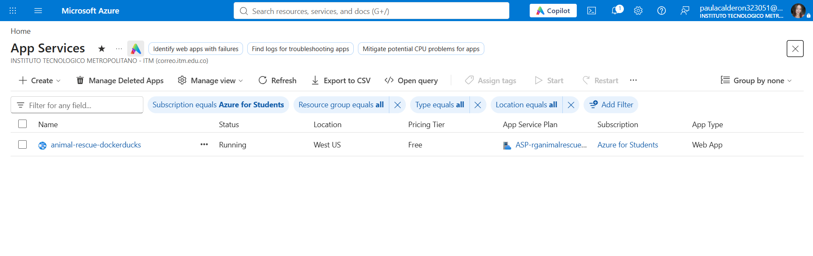
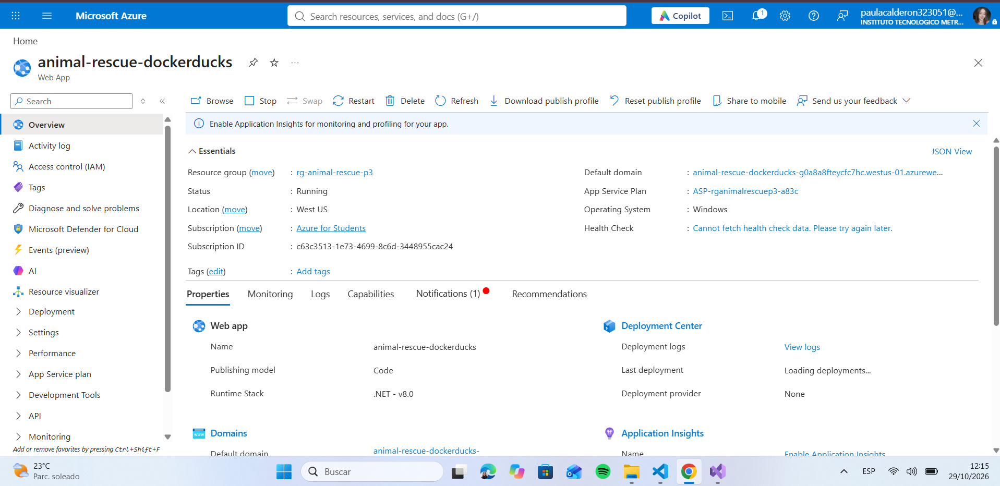
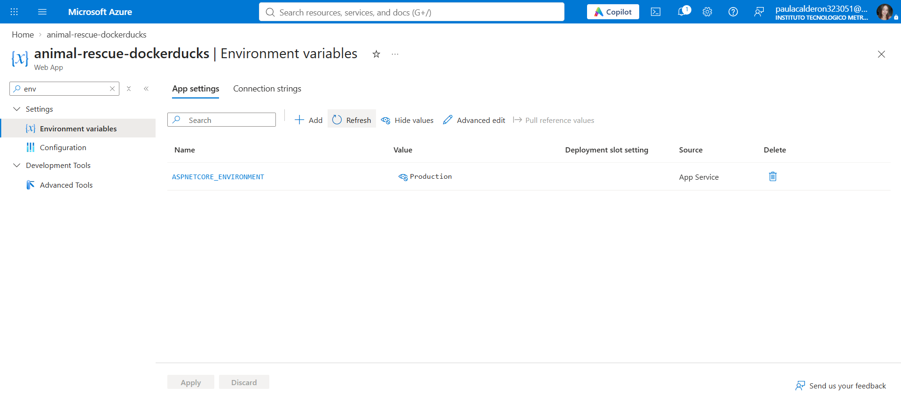
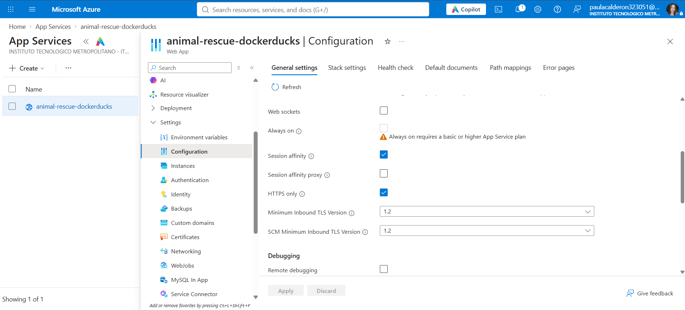
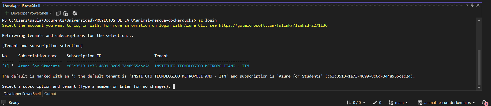
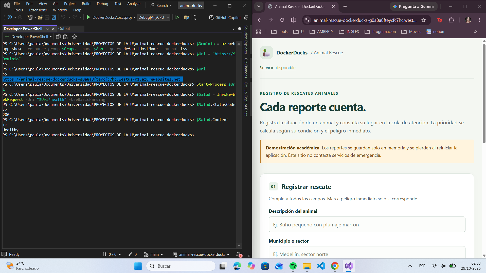
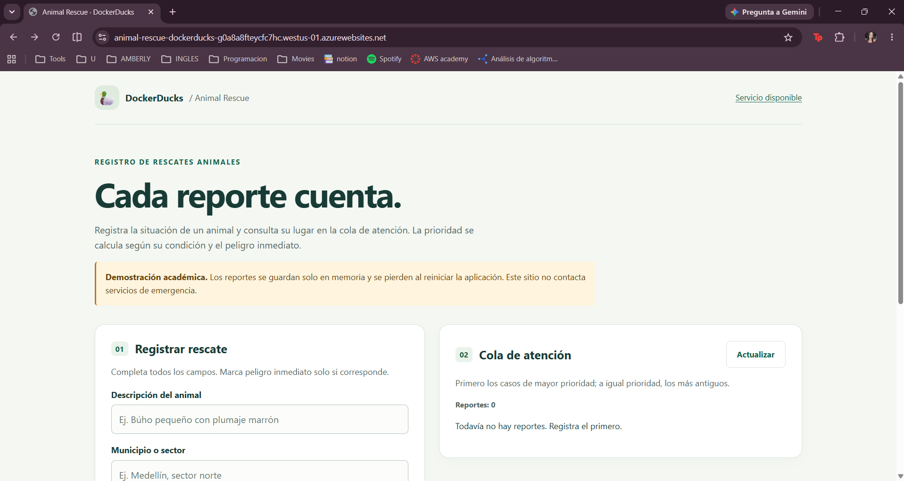
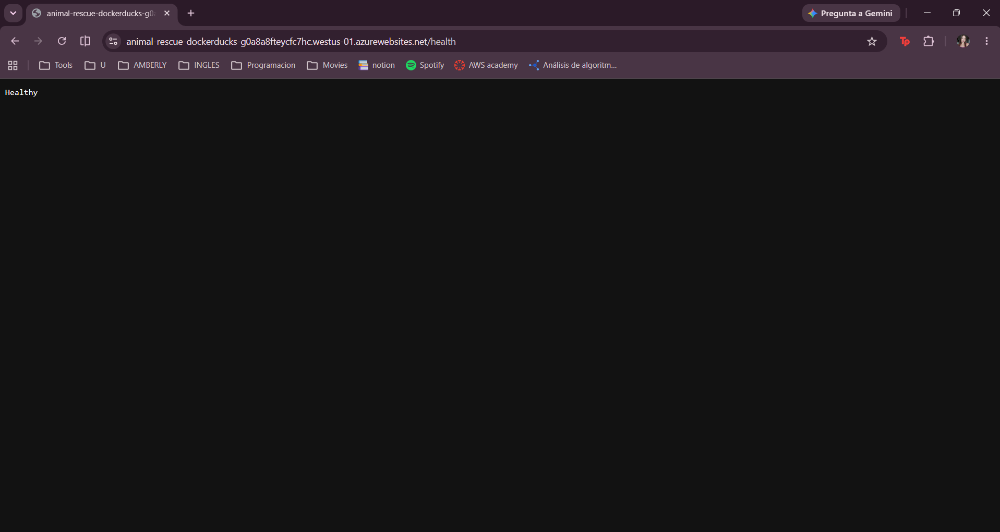
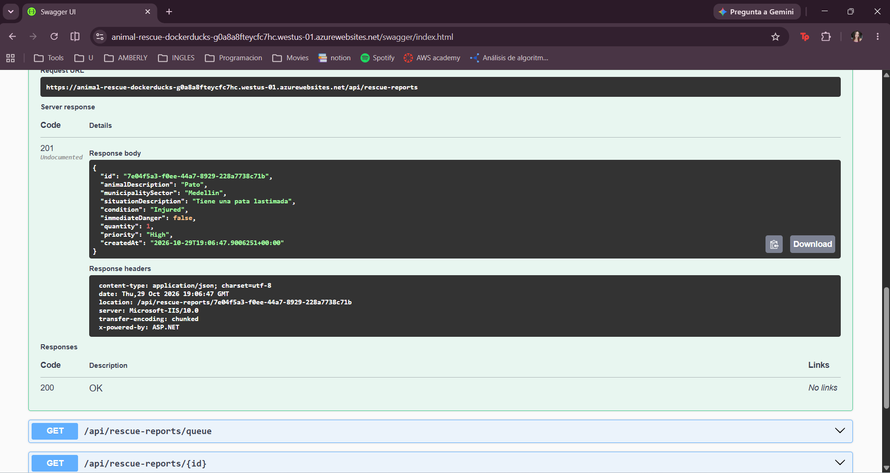

# Animal Rescue · DockerDucks

Aplicación académica para registrar rescates animales y consultar una cola ordenada por prioridad. Reutiliza la API de la práctica 2 y agrega una interfaz HTML/CSS/JavaScript integrada en ASP.NET Core .NET 8, publicada en **IIS (on-premises)** y en **Azure App Service**, sin Docker ni base de datos.

**Práctica 3 · Despliegue de Software · 2026** · Instituto Tecnológico Metropolitano (ITM)

## Integrantes y responsabilidades

| Integrante | Responsabilidad | Contribución realizada |
| --- | --- | --- |
| Sara Regino Ferraro | Líder de repositorio | Estructura del repositorio (`src/`, `tests/`, `evidencias/iis/`, `evidencias/azure/`) y acceso del docente `oalarconpe`. |
| Alejandra Madrid Calderon | IIS | Habilitó IIS en su equipo, creó el App Pool `AnimalRescuePool`, el sitio `AnimalRescue` (puerto 8080), configuró permisos de la carpeta publicada y verificó `/` y `/health`. Evidencias en `evidencias/iis/`. |
| Paula Andrea Calderon Quintero | Azure | Creó el App Service `animal-rescue-dockerducks`, publicó la aplicación, configuró `ASPNETCORE_ENVIRONMENT=Production` y HTTPS Only, y verificó la URL pública, `/health` y Swagger. Evidencias en `evidencias/azure/`. |
| Juan David Velasquez Murillo | Aplicación y `/health` | Interfaz, API, pruebas y preparación de la versión publicable (`dotnet publish` en Release). |
| Jose David Vasquez Diaz | Documentación y video | README final, organización de las evidencias y coordinación/edición del video. |

## Estado de la entrega

| Dato | Estado |
| --- | --- |
| Aplicación y publicación Release | Verificadas localmente, en IIS y en Azure App Service. |
| Fecha de publicación en IIS | **28 de octubre de 2026** |
| Fecha de publicación en Azure | **29 de octubre de 2026** |
| URL pública HTTPS de Azure | <https://animal-rescue-dockerducks-g0a8a8fteycfc7hc.westus-01.azurewebsites.net/> |
| Verificación de `/health` en Azure | <https://animal-rescue-dockerducks-g0a8a8fteycfc7hc.westus-01.azurewebsites.net/health> |
| Video con participación de todos | <https://youtu.be/7nCn34XqEmE> |
| Acceso del docente | Repositorio compartido con el usuario de GitHub `oalarconpe` (invitación por nombre de usuario, no por correo). |

## Resumen técnico

| Elemento | Detalle |
| --- | --- |
| Tecnología | ASP.NET Core .NET 8 (minimal API) + interfaz HTML/CSS/JavaScript servida desde `wwwroot/` |
| Persistencia | En memoria (sin base de datos) |
| Punto de entrada | `/` (página principal servida con `UseDefaultFiles` + `UseStaticFiles`) |
| Comprobación de salud | `/health` → HTTP 200 con `Healthy` |
| Documentación de la API | `/swagger/` |
| IIS | Windows 11, sitio `AnimalRescue`, App Pool `AnimalRescuePool`, puerto `8080` |
| Azure | App Service (Web App) en Windows, runtime .NET 8, región West US, plan Free, grupo de recursos `rg-animal-rescue-p3` |

## Ejecutar localmente

Requiere **SDK .NET 8**. Desde la raíz del repositorio:

```sh
dotnet run --project src/DockerDucks.Api --no-launch-profile --urls http://localhost:5080
```

Abrir `http://localhost:5080/`. Recursos disponibles:

| Ruta | Función |
| --- | --- |
| `/` | Formulario y cola de atención. |
| `/health` | Salud básica del proceso; debe responder HTTP 200 con `Healthy`. |
| `/swagger/` | Exploración y pruebas manuales de la API. |
| `POST /api/rescue-reports` | Registrar un reporte. |
| `GET /api/rescue-reports/queue` | Cola por prioridad y antigüedad. |
| `GET /api/rescue-reports/{id}` | Consultar un reporte por identificador. |

La prioridad la calcula el servidor: condición crítica o peligro inmediato → **crítica**; herido → **alta**; estable → **media**. A igual prioridad se atiende primero el reporte más antiguo. La cola se consulta al abrir la página, después de registrar y con **Actualizar**; no hay actualización en tiempo real.

> Los datos existen solo en memoria: se pierden al reiniciar, volver a desplegar o reciclar el proceso. Cada instancia tiene su propia cola. No hay autenticación: cualquiera con acceso puede leer y crear reportes. No ingresar información sensible. Esta aplicación no contacta servicios de emergencia.

## Pruebas

API, prioridades e interfaz servida en Production:

```sh
dotnet test DockerDucks.sln --configuration Release
```

Pruebas de navegador opcionales (requieren Node.js 20+; **Node no se necesita en producción**):

```sh
cd tests/browser
npm ci
npx playwright install chromium
npm test
```

La suite inicia una aplicación local dedicada en `http://127.0.0.1:5187`, registra datos de prueba y la detiene al terminar. No ejecutar contra una entrega compartida: crea reportes.

Para probar un artefacto publicado que ya esté ejecutándose localmente, definir `BASE_URL` antes de `npm test`: en PowerShell, `$env:BASE_URL="http://127.0.0.1:5188"`; en bash, `BASE_URL=http://127.0.0.1:5188 npm test`.

## Preparar la publicación

Desde la raíz del repositorio, después de aprobar las pruebas:

```sh
dotnet publish src/DockerDucks.Api/DockerDucks.Api.csproj --configuration Release --output artifacts/publish
```

Publicar **todo el contenido de `artifacts/publish/`**, no el código fuente ni solo el ejecutable. Incluye `DockerDucks.Api.dll`, dependencias, `wwwroot/` y el `web.config` generado automáticamente para ASP.NET Core Module. No editarlo ni eliminarlo.

---

## Parte 1 · Publicación en IIS (on-premises)

**Fecha:** 28 de octubre de 2026 · **Equipo:** Windows 11 · **Responsable:** Alejandra Madrid Calderon

### Configuración aplicada

| Elemento | Valor |
| --- | --- |
| Servidor IIS | Equipo local de Windows 11 |
| Application Pool | `AnimalRescuePool` (sin código administrado, canalización integrada) |
| Sitio | `AnimalRescue` |
| Ruta física | `C:\inetpub\AnimalRescue\publish` |
| Binding | `http`, todas las direcciones IP no asignadas, puerto `8080` |
| Punto de entrada | `/` (documento predeterminado servido por la aplicación) |
| Permisos | `AnimalRescuePool` con lectura y ejecución sobre `C:\inetpub\AnimalRescue` |
| Verificación | `http://localhost:8080` y `http://localhost:8080/health` |

Requisito en el servidor: instalar el **.NET 8 Hosting Bundle** después de habilitar IIS.

### Evidencias de IIS

**1. Application Pool utilizado para la aplicación** (`AnimalRescuePool`, sin código administrado, 1 aplicación asociada)


**2. Configuración del sitio en IIS** (nombre, grupo de aplicaciones, ruta física y binding en el puerto 8080)


**3. Sitios, ruta de acceso y binding** (`*:8080 (http)` → `C:\inetpub\AnimalRescue\publish`)


**4. Aplicación funcionando en el navegador** (`http://localhost:8080`)


**5. Verificación de `/health`** (`http://localhost:8080/health` → `Healthy`)


**6. Permisos de la carpeta para la identidad del App Pool** (`AnimalRescuePool`: lectura y ejecución)


---

## Parte 2 · Publicación en Azure App Service

**Fecha:** 29 de octubre de 2026 · **Responsable:** Paula Andrea Calderon Quintero

### Configuración aplicada

| Elemento | Valor |
| --- | --- |
| Recurso | Web App `animal-rescue-dockerducks` |
| Grupo de recursos | `rg-animal-rescue-p3` |
| Suscripción | Azure for Students |
| Región / plan | West US / Free |
| Sistema operativo y runtime | Windows · .NET 8 |
| Modelo de publicación | Código |
| Application Setting | `ASPNETCORE_ENVIRONMENT=Production` |
| HTTPS Only | Habilitado (TLS mínimo 1.2) |
| URL pública | <https://animal-rescue-dockerducks-g0a8a8fteycfc7hc.westus-01.azurewebsites.net/> |
| `/health` | <https://animal-rescue-dockerducks-g0a8a8fteycfc7hc.westus-01.azurewebsites.net/health> |
| Swagger | <https://animal-rescue-dockerducks-g0a8a8fteycfc7hc.westus-01.azurewebsites.net/swagger/index.html> |

### Evidencias de Azure

**1. App Service creado** (estado *Running*, West US, plan Free)



**2. Identificación del recurso** (grupo de recursos, dominio predeterminado, plan, runtime .NET 8)



**3. Application Setting configurado** (`ASPNETCORE_ENVIRONMENT=Production`, sin secretos)



**4. HTTPS Only habilitado**



**5. Autenticación en Azure con Azure CLI** (`az login`)



**6. Verificación del despliegue** (URL obtenida con Azure CLI, `/health` con código 200 y contenido `Healthy`, y la aplicación abierta en el navegador)



**7. Aplicación funcionando en la URL pública (HTTPS)**



**8. Verificación de `/health` en Azure**



**9. Swagger público: registro de un reporte (`201 Created`)**



---

## Notas para reproducir o verificar el despliegue

- **Azure:** abrir la URL pública, comprobar que redirige a HTTPS y que `/health` responde `Healthy`. Application Settings y HTTPS Only están en *Settings → Environment variables* y *Settings → Configuration* del recurso.
- **IIS:** requiere IIS habilitado y el .NET 8 Hosting Bundle. Crear el App Pool sin código administrado, un sitio apuntando a la carpeta de publicación con binding en un puerto libre (en este caso `8080`) y conceder lectura/ejecución a la identidad del App Pool. Verificar `/` y `/health`.
- **ZIP Deploy en Azure:** comprimir el **contenido** de la carpeta de publicación, sin agregar una carpeta contenedora adicional.
- **Plan Free:** al no permitir *Always on*, la aplicación puede entrar en reposo por inactividad; la primera petición puede tardar. Como los datos están en memoria, se pierden al reiniciar.
- Los reportes **no se comparten** entre IIS y Azure: son dos procesos independientes.
- Las evidencias no incluyen contraseñas, tokens, cadenas de conexión ni perfiles de publicación.

## Estructura del repositorio

```
animal-rescue-dockerducks/
├─ README.md
├─ DockerDucks.sln
├─ src/
│  └─ DockerDucks.Api/
├─ tests/
│  ├─ DockerDucks.Api.Tests/
│  └─ browser/
└─ evidencias/
   ├─ iis/images/
   └─ azure/images/
```

## Referencias

- [Practica2Contenerizacion_DockerDucks](https://github.com/ArsaOniSaturn/Practica2Contenerizacion_DockerDucks)
- [ASP.NET Core en IIS — Microsoft Learn](https://learn.microsoft.com/en-us/aspnet/core/host-and-deploy/iis/?view=aspnetcore-8.0)
- [Publicación ZIP en App Service — Microsoft Learn](https://learn.microsoft.com/en-us/azure/app-service/deploy-zip)
