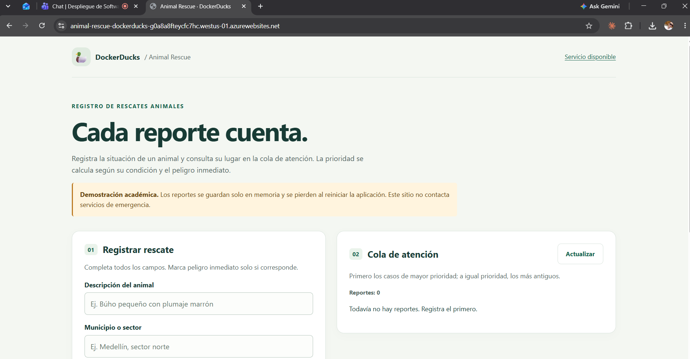
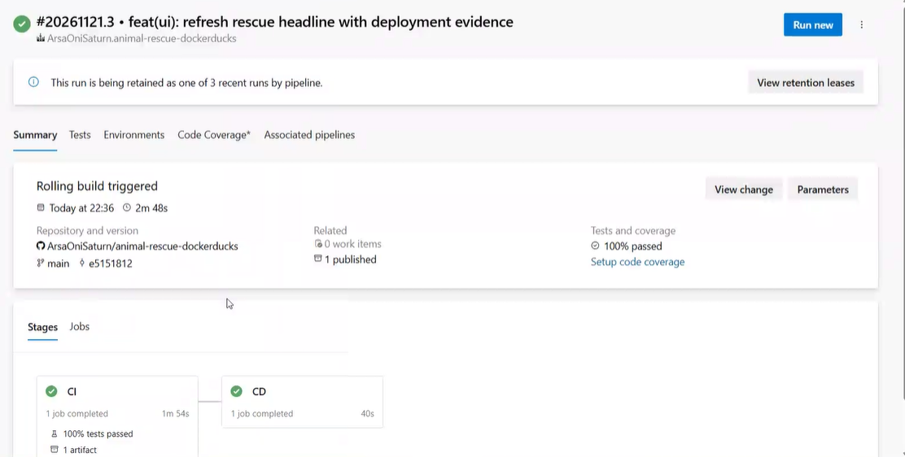
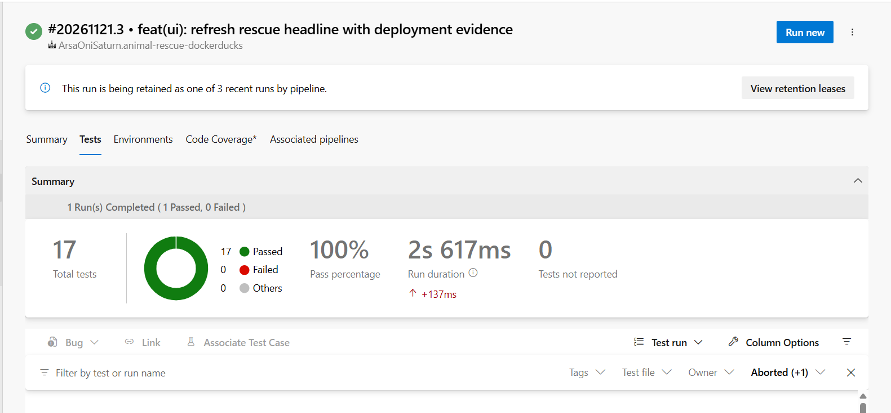
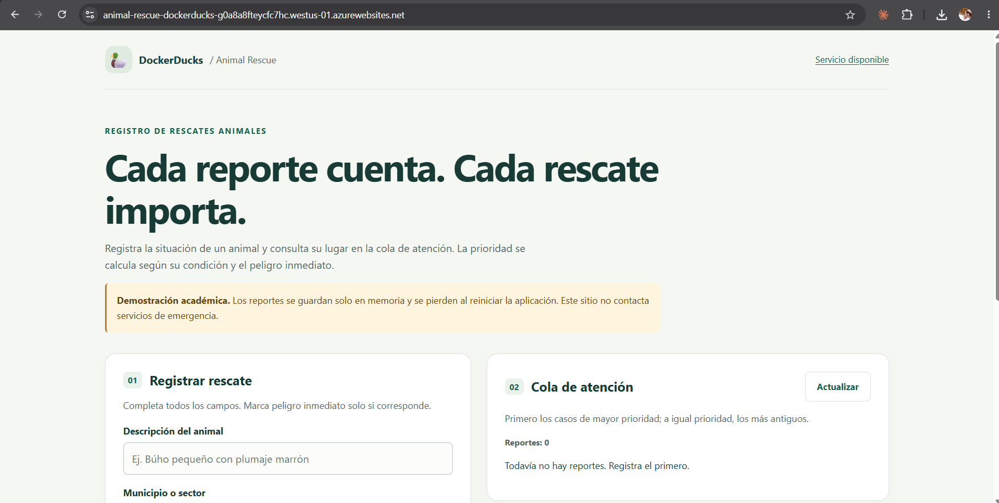

# Informe de evidencias de integración y entrega continuas

El caso documentado es el run automático `20261121.3`, BuildId `3`,
commit `e515181264bd26c601e56c64ed4d45105af8259a` de la rama `main`.
Las capturas y los registros corresponden a ese despliegue, no necesariamente
a la versión más reciente de la aplicación.

- [Ejecución de Azure Pipelines](https://dev.azure.com/dockerducks-animal-rescue/AnimalRescue/_build/results?buildId=3&view=results)
- [Commit del cambio](https://github.com/ArsaOniSaturn/animal-rescue-dockerducks/commit/e515181264bd26c601e56c64ed4d45105af8259a)
- [Aplicación pública](https://animal-rescue-dockerducks-g0a8a8fteycfc7hc.westus-01.azurewebsites.net/)
- [Configuración del flujo](../../docs/CI_CD.md)

## Cambio visible y trazabilidad

| Fase | Evidencia | Resultado |
| --- | --- | --- |
| Antes del cambio | [Captura](u4-antes.png) · [Registro HTTP](u4-antes.json) | H1 «Cada reporte cuenta.», SHA `f0ea27f305959f4bbd4d02a96dce7339d36fa918`, BuildId `2` |
| Activación automática | [Run CI/CD](u4-run.png) | `Rolling build triggered`, rama `main`, CI y CD exitosas, un artefacto |
| Pruebas | [Detalle de tests](u4-tests.png) | 17 aprobadas, 0 fallidas en el run `20261121.3` |
| Artefacto | [Manifiesto de inspección](u4-artefacto.json) | ZIP de publicación con SHA y BuildId del run `3` |
| Aplicación publicada | [Captura](u4-despues.png) · [Registro HTTP](u4-despues.json) | H1 «Cada reporte cuenta. Cada rescate importa.», salud e identidad verificadas |

El antecedente BuildId `2` corresponde al run `20261121.2`. El conteo de
17 pruebas se acredita para el run `3` mediante la captura de detalle;
no se infiere del porcentaje de aprobación del run anterior.

## Estado inicial de la aplicación

Antes del cambio, la aplicación publicada mostraba el encabezado
«Cada reporte cuenta.». El registro HTTP identifica esa versión con
BuildId `2` y SHA `f0ea27f305959f4bbd4d02a96dce7339d36fa918`.

*Figura 1. Estado previo de Animal Rescue en su URL pública. Fuente: captura del equipo en Azure App Service.*

## Ejecución automática de CI y CD

El cambio en `main` activó el run `20261121.3`. La captura muestra
`Rolling build triggered`, el commit `e5151812`, las etapas CI y CD exitosas
y un artefacto publicado. Esta ejecución vincula el cambio de código con
la construcción y el despliegue automatizados.

*Figura 2. Resumen de Azure Pipelines: rama main, activación automática, CI, CD y artefacto. Fuente: captura del equipo en Azure Pipelines.*

## Resultados de las pruebas

El detalle del mismo run registra **17 pruebas aprobadas y 0 fallidas**.
El 100 % corresponde al porcentaje de aprobación de las pruebas ejecutadas,
no a la cobertura del código.

*Figura 3. Resultados de las pruebas automatizadas del run 20261121.3. Fuente: captura del equipo en Azure Pipelines.*

## Artefacto consumido por CD

- Nombre publicado: `animal-rescue-web`; paquete: `animal-rescue.zip`.
- Tamaño del ZIP inspeccionado: **896652 bytes**; 17 entradas y CRC correcto.
- SHA-256: `75f85214b55a1ddbda98c45d2a023dc20d5cb4550b7657ccba2bf02adcebb6dc`.
- Contenido en raíz: DLL, `web.config`, dependencias, runtime y `wwwroot/`.
- `wwwroot/build-info.json`: SHA `e515181264bd26c601e56c64ed4d45105af8259a`, BuildId `3`.

El manifiesto conserva el inventario de rutas, tamaños y CRC. La CD descarga
el artefacto del mismo run y lo despliega sin reconstruir la aplicación.

## Verificación de la aplicación publicada

El registro posterior conserva las URL, fechas UTC y respuestas completas:
`/health`, `/` y `/build-info.json` devolvieron HTTP 200. La salud respondió
`Healthy`; el HTML contenía el nuevo H1 y el aviso de demostración académica;
el SHA y BuildId publicados coincidían con los del artefacto.

La interfaz desplegada muestra el encabezado
**«Cada reporte cuenta. Cada rescate importa.»** y conserva el aviso sobre
datos en memoria y ausencia de contacto con servicios de emergencia.

*Figura 4. Resultado del despliegue del run 20261121.3 en Azure App Service. Fuente: captura del equipo.*

El contraste con la figura 1 demuestra el cambio visible. Los registros JSON
complementan las capturas con la identidad de la versión publicada.

## Comprobación pública posterior: BuildId 6

El [registro de salud e identidad](verificacion-build-6.json) conserva HTTP 200
en `/`, `/health` y `/build-info.json`, respuesta `Healthy`, SHA
`c07c412e992559ede09fe770e55959e951a193f3` y BuildId `6`. La interfaz mostró
«Cada reporte cuenta. Los animales tienen voz.». Esta comprobación no acredita
el conteo de pruebas remotas del run 6 ni reemplaza el caso integral del run 3.

## Conclusión

El caso documentado permite seguir la cadena **commit en main → CI → pruebas →
artefacto → CD → aplicación publicada**. Las capturas muestran el proceso y el
cambio visible; el manifiesto y las respuestas HTTP relacionan el paquete
con la versión desplegada mediante SHA y BuildId.

Las carpetas [Azure](../azure/) e [IIS](../iis/) conservan evidencias de la
configuración inicial de la práctica 3. No sustituyen las evidencias del
flujo automático CI/CD descrito aquí.
